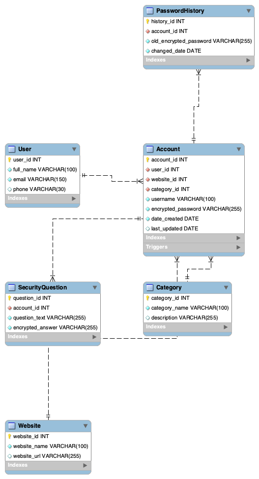

# Password Management System

## Project Overview

A relational database system designed to manage user accounts, website credentials, account categories, password history, and security questions.

The implementation emphasizes relational database design, data integrity, normalization, transaction management, and automated database operations.

## Technologies Used

- SQL
- MySQL 8.4
- MySQL Workbench
- Git & GitHub

## Key Features

- Six relational database tables
- Five one-to-many relationships
- Primary and foreign key constraints
- Third Normal Form (3NF) database design
- CRUD operations
- Multi-table JOIN queries
- Aggregate queries and reporting
- Automated password-history trigger
- Transaction management
- COMMIT and ROLLBACK operations

## Database Architecture

The database consists of six entities:

- User
- Account
- Website
- Category
- PasswordHistory
- SecurityQuestion

The Account table serves as the central entity, connecting users, websites, categories, password history, and security questions.

## Entity Relationship Diagram



## Project Structure

```text
Password-Management-System/
├── design/
│   ├── Password_Management_System.mwb
│   └── password_er_diagram.png
├── sql/
│   ├── schema.sql
│   ├── seed.sql
│   ├── use_cases.sql
│   └── Password_Management_System_Official.sql
├── .gitignore
└── README.md
```

## Database Setup

### Requirements

- MySQL Server 8.4
- MySQL Workbench (optional)

Clone the repository and navigate to its root directory.

Run the master SQL script:

```bash
mysql -u root -p < sql/Password_Management_System_Official.sql
```

**Warning:** The master script drops and recreates the `password_management_system` database. Only execute it in a development or testing environment where existing data can be discarded.

## Database Testing

The database was tested using:

- INSERT and SELECT operations
- UPDATE and ROLLBACK operations
- DELETE and COMMIT operations
- Automated password-history trigger
- Multi-table JOIN queries
- Aggregate reporting queries

## Security and Privacy

This project uses fictional demonstration data and placeholder encrypted password values.

The implementation is a relational database prototype, not a production-ready password manager.

Actual encryption, authentication, and secure key management are outside its current scope.
